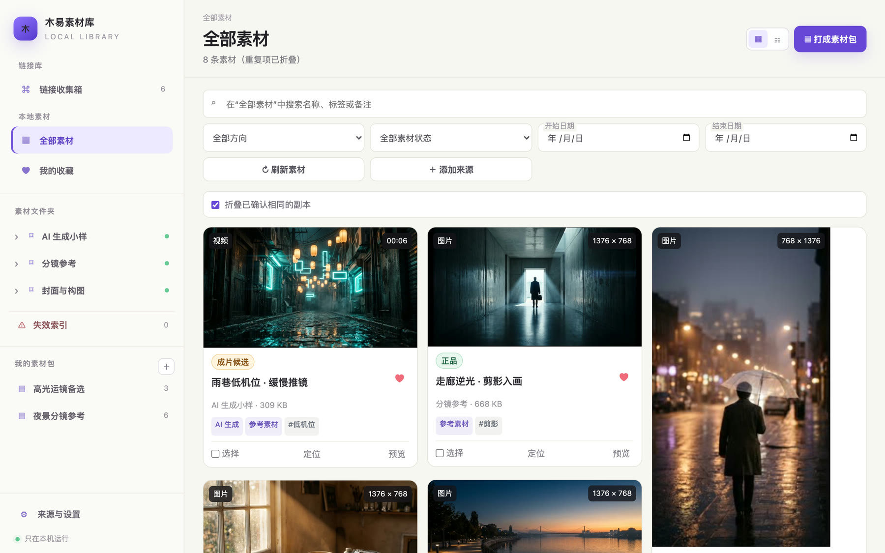
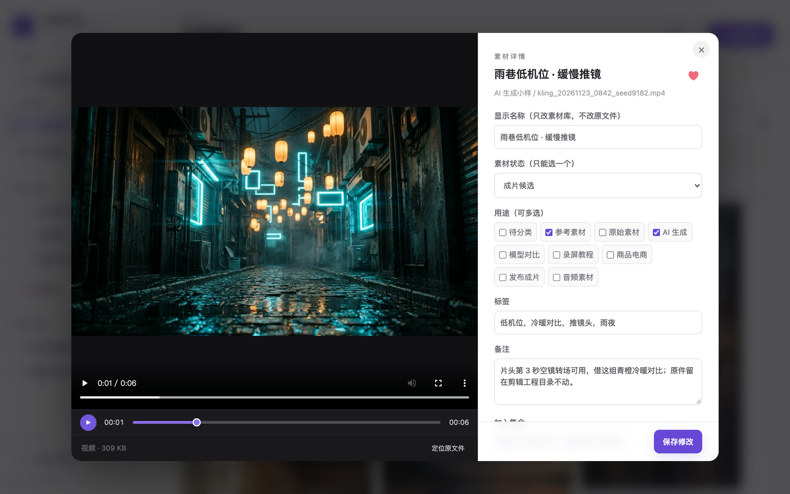
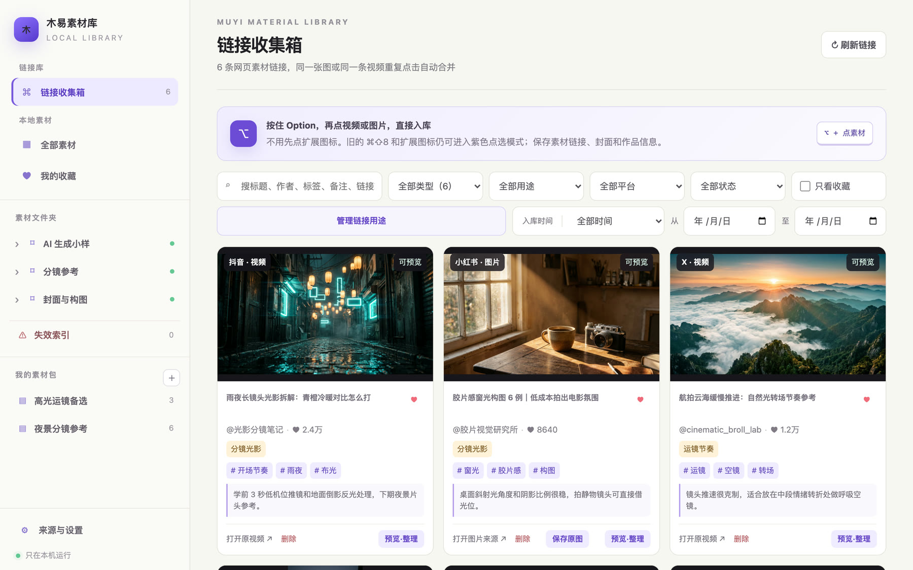

# 木易素材库 · Muyi Library

**把散落在硬盘、抖音、小红书和 X 的视觉灵感，统一收进你自己的本地素材库。**

原地索引不占双倍硬盘 · 跨平台一键收灵感 · 100% 本机运行 · 免费开源（MIT）

[][release]

[**下载 Windows x64**][windows] · [**下载 Apple 芯片 Mac**][mac] · [**下载 Chrome 收集器**][collector] · [**中文安装指南**](docs/INSTALL.zh-CN.md)

 

<em>主界面实拍：同一页面混合预览横版分镜、竖版封面与视频小样，按方向、状态、日期与关键词秒级检索。（界面演示图片与视频均为 AI 生成的合成样例）</em>

---

## 为什么用木易素材库？

做 AI 视频、剪辑或视觉设计时，参考图、生成小样和刷到的好镜头往往散落在十几个文件夹和三四个 App 的收藏夹里——**真正要排分镜、找转场时，怎么都翻不到。**

木易素材库专为创作者设计，解决 4 个最烦人的日常痛点：

- **原地索引，绝不乱动原文件**  
  直接扫描你现有的文件夹，**不复制、不移动、不改名**任何原始素材。既不会把几百 GB 素材拷贝进私有包撑爆硬盘，也不会破坏剪映、Premiere 或达芬奇的工程路径；随时一键「定位」回到原目录。
- **专治乱码生成名，用创作语言找回素材**  
  AI 生成结果只有一串 `kling_20261123_seed9182.mp4` 也没关系——在库里直接起可读标题、标素材状态（原始素材 / 成片候选 / 正品）、加标签与分镜备注，并跨目录打进「素材包」。原文件名不动，过两周搜「雨夜」「推镜头」照样一秒找回。
- **刷到好参考，顺手收进「链接收集箱」**  
  装上配套 Chrome 收集器，在抖音、小红书、X 或任意网页按住 **Alt**（Windows）/ **Option**（Mac）点击图片或视频即可入库。同一作品重复采集自动去重合并，支持写拆解笔记、一键跳回原帖；网页提供可读取原图时支持一键保存本地，可读取的直连视频也可手动留底。
- **100% 本机运行，开箱即用、免费开源**  
  所有索引、标签、备注与收藏都只存在你自己电脑上，不登录账号、不上传云端、无订阅费。安装包内置 PostgreSQL，双击直接启动，无需手动折腾数据库。

---

## 核心工作流一览

### 1. 边看小样边整理，不碰原文件一分一毫

- **所见即所得**：详情页直接预览图片与视频片段，支持拖拽进度条核对运镜细节，随时点击「定位原文件」跳回系统文件夹。
- **非破坏式整理**：如上图所示，原件保留在 `AI 生成小样 / kling_20261123_0842_seed9182.mp4`，库内显示名称改为「雨巷低机位 · 缓慢推镜」，同时记录分镜备注、用途分类、标签与所属素材包。

### 2. 跨平台「链接收集箱」，把刷到的灵感沉淀成参考库

- **不用切来切去翻收藏夹**：抖音、小红书、X 刷到的运镜、构图和调色参考全部汇入同一个本机收件箱，按平台、类型、用途、收藏和关键词统一筛选。
- **留出处，也留笔记**：记录「学前 3 秒低机位推镜」「封面留白比例」等拆解备注，复盘时点「打开原视频 / 打开图片来源」直接回到原作品页；网页提供可读取原图时可直接点「保存原图」落盘到「网页采集」来源。

---

## 与常见整理方式的对比

| 你平时怎么管素材 | 常见痛点 | 用木易素材库 |
| :--- | :--- | :--- |
| **系统文件夹** | 视频和图混在一起难找；文件名乱码搜不到；一个素材想同时放两个项目只能复制一份 | 统一瀑布流预览 + 标签/备注/状态/画幅秒搜 + 虚拟「素材包」跨目录复用 |
| **抖音 / 小红书 / X 各自收藏夹** | 平台割裂、搜不到自己想借的镜头、没法写分镜备注、回头刷半天找不到 | Chrome 按 `Alt`/`Option` 一键统一收进本机收集箱，写备注、打标签、一键回原帖 |
| **拷贝式私有素材库 / 网盘** | 动辄把几十上百 GB 素材再拷贝一遍占双倍硬盘，或上传云端限速且需要付费订阅 | **原地索引不拷贝、不改工程路径**，100% 本地运行，MIT 协议免费开源 |

---

## 30 秒快速上手

| 系统平台 | 安装包 | 启动方式 |
| :--- | :--- | :--- |
| **Windows x64** | [`MuyiMaterialLibrary-windows-x64.zip`][windows] | 先安装 [微软 Visual C++ x64 运行库][vc-runtime]，解压完整目录后双击 `MuyiMaterialLibrary.exe`。 |
| **Apple 芯片 Mac** | [`MuyiMaterialLibrary-macOS-arm64.dmg`][mac] | 打开 DMG，把应用拖进「应用程序」后双击启动。 |
| **Chrome 收集器** | [`MuyiMaterialLibrary-chrome-collector-v0.5.1.zip`][collector] | 解压后在 `chrome://extensions/` 开启开发者模式并加载已解压扩展，再与本地库配对。 |

首次启动会自动初始化内置 PostgreSQL 并打开本地空库，你可以任选一条路径立刻开始：

1. **先收网页灵感（零额外依赖）**  
   按 [Chrome 收集器安装与配对步骤](docs/INSTALL.zh-CN.md#3-安装和配对-chrome-收集器) 完成配对，在网页上按住 **Alt**（Win）/ **Option**（Mac）点击图片或视频，即可在「链接收集箱」查看和整理。
2. **整理本地图片与视频文件夹**  
   扫描本地媒体、生成缩略图预览或保存网页原件需要本机安装 FFmpeg 与 FFprobe（Windows 可用 `winget install --id Gyan.FFmpeg -e`，Mac 可用 `brew install ffmpeg-full`，详见 [媒体工具安装说明](docs/INSTALL.zh-CN.md#2-需要导入本地文件或保存网页原件时安装媒体工具)）。装好后重启素材库，点击「添加来源」选中文件夹即可。

> 更多关于首次打开系统提示、数据目录位置、备份迁移、卸载与排错，见 [**完整中文安装与使用指南**](docs/INSTALL.zh-CN.md)。

<strong>公测说明、验证范围与已知边界（点击展开）</strong>

 

- **当前阶段**：本项目目前为 **公开测试版（`v0.2.3-preview.1`）**。
- **签名状态**：Windows 试用包暂未做 Authenticode 签名，Mac 应用使用临时签名且未通过 Apple 公证；下载前建议对照 [Release 页面][release] 的 SHA-256 校验值，首次打开如遇系统拦截请参考 [安装说明](docs/INSTALL.zh-CN.md#1-打开素材库)。
- **验证环境**：空库启动、图片与视频导入、预览、链接收集以及退出重启后的数据读回，已在 Windows Server 2025 x64 和 Apple 芯片 macOS 15 托管环境完成自动化验收；更多真机桌面场景持续完善中。
- **网页媒体保存边界**：抖音、小红书和 X 的作品默认保存为链接卡片以回到原出处；原图一键保存与视频手动留底是否可用，取决于目标网页实际提供的可读取媒体地址。Chrome 收集器仅在本地与你的素材库通信，不读取或上传浏览器 Cookie 与浏览历史。

---

## 技术栈、开发与开源许可

- **架构**：Vue + Vite 前端 · Python 本机服务 · 随包独立 PostgreSQL · Chrome Manifest V3 收集器
- **从源码运行与构建**：见 [独立版开发与构建说明](docs/STANDALONE.md)
- **问题反馈与功能建议**：欢迎在 [GitHub Issues][issues] 附上操作系统、版本号、复现步骤与脱敏日志片段
- **开源许可**：项目源码与 Chrome 收集器采用 [MIT 许可证](LICENSE)；安装包随附的第三方组件适用各自的 [第三方许可证说明](THIRD_PARTY_NOTICES.md)

[release]: https://github.com/yimu86474-cpu/muyi-library/releases/tag/v0.2.3-preview.1
[windows]: https://github.com/yimu86474-cpu/muyi-library/releases/download/v0.2.3-preview.1/MuyiMaterialLibrary-windows-x64.zip
[mac]: https://github.com/yimu86474-cpu/muyi-library/releases/download/v0.2.3-preview.1/MuyiMaterialLibrary-macOS-arm64.dmg
[collector]: https://github.com/yimu86474-cpu/muyi-library/releases/download/v0.2.3-preview.1/MuyiMaterialLibrary-chrome-collector-v0.5.1.zip
[issues]: https://github.com/yimu86474-cpu/muyi-library/issues
[vc-runtime]: https://aka.ms/vc14/vc_redist.x64.exe
