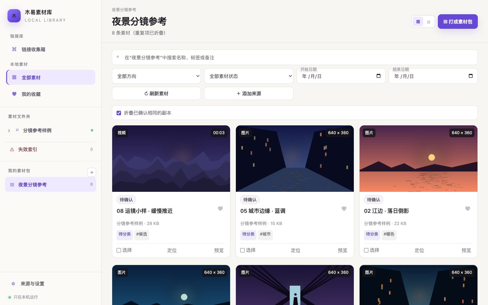

# 木易素材库

**给 AI 视频、剪辑和视觉创作者用的本地素材库。**

做片子时，把参考图、视频小样和网页上的作品链接收在一起。过几天想找回某个镜头，搜你写过的关键词，就能继续看素材、读备注或回到原帖。

## 整理以后是什么样

- **一眼看清手头的素材。** 给素材库添加常用文件夹，在同一个页面预览不同文件夹里的图片和视频。原件留在原来的位置，标签、备注和收藏保存在本机。
- **用创作时的关键词找回来。** 文件名只有一串生成编号，也能靠你加的「逆光」「雨夜」「可用镜头」等标签和备注找回。挑好的素材可以收藏，或者归进某个项目的素材包。
- **看到好参考，顺手收下来。** 在 Chrome 按住 Windows 的 **Alt** 或 Mac 的 **Option** 点选网页素材。抖音、小红书和 X 的作品可保存为链接，从「链接收集箱」回到原出处。网页提供可读取的原图时，可以一键保存。网页提供可读取的视频直链时，也可以手动保存。

*「夜景分镜参考」素材包的实际界面。示例图片和视频均为合成测试素材。*

## 这些时候可以用

| 场景 | 一个用法 |
| --- | --- |
| **做分镜，找画面参考** | 把雨巷、逆光和推镜头这些参考放进同一个素材包，在备注里写下「借光线」或「借运镜」。排镜头时能一起翻看。 |
| **做 AI 视频，筛生成小样** | 添加生成结果文件夹，逐条预览小样。给选中的版本加「候选」标签，再写下「开头能用，后半段动作不稳」，回头接着筛。 |
| **剪辑时，找回某个片段** | 给选中的片段记上「近景」「回头」或「结尾有空镜」。下次剪到这里，按标签和备注找到它，预览后回到原文件。 |
| **做封面，按画幅找构图** | 先筛竖版，再搜「留白」或「人物居中」。做横版封面时切换方向，就能接着找另一个画幅的参考。 |
| **刷到好作品，留作之后拆解** | 点选作品，把链接收进收集箱。顺手记下「想研究开场节奏」。之后翻到这条，直接回原帖看完整作品。 |
| **整理旧项目，把能复用的挑出来** | 把几个项目的旧文件夹添加为来源，预览时把常用空镜和场景图点成收藏。下个项目从「我的收藏」里挑，原文件仍在各自的项目目录。 |

## 下载与安装

[下载 Windows x64][windows] · [下载 Apple 芯片 Mac][mac] · [下载 Chrome 收集器][collector] · [中文安装说明](docs/INSTALL.zh-CN.md)

| 你的电脑 | 怎么开始 |
| --- | --- |
| Windows x64 | 安装 [微软 Visual C++ x64 运行库][vc-runtime]，解压 [Windows ZIP][windows]，双击 `MuyiMaterialLibrary.exe`。 |
| Apple 芯片 Mac | 打开 [Mac DMG][mac]，把应用拖到「应用程序」后打开。 |

打开后会出现一个本地空库，数据库随应用一起提供。你可以选一个常用工作流开始：

1. **先收链接。** 按 [收集器配对步骤](docs/INSTALL.zh-CN.md#3-安装和配对-chrome-收集器) 配对 Chrome 扩展。挑一条想留作参考的作品，点选后到「链接收集箱」查看。
2. **先整理本地文件。** 按 [媒体工具安装说明](docs/INSTALL.zh-CN.md#2-需要导入本地文件或保存网页原件时安装媒体工具) 装好 FFmpeg 和 FFprobe，重启素材库，然后点「添加来源」，选一个装着参考图或视频的文件夹。

当前是**公开测试版**。空库启动、图片和视频导入、退出重启后的读回已在 Windows Server 2025 x64 和 Apple 芯片 macOS 15 的托管环境验证。Windows 包暂未签名，Mac 包使用临时签名且未公证。首次打开、系统提示和备份见 [完整安装说明](docs/INSTALL.zh-CN.md)。安装包校验值在 [Release][release]。

## 开发、反馈与许可

- [从源码运行或构建 Windows 与 Mac 版本](docs/STANDALONE.md)
- [报告问题或建议功能][issues]
- 项目代码和 Chrome 收集器采用 [MIT](LICENSE)，安装包中的依赖适用各自的 [第三方许可证](THIRD_PARTY_NOTICES.md)。

[release]: https://github.com/yimu86474-cpu/muyi-library/releases/tag/v0.2.3-preview.1
[windows]: https://github.com/yimu86474-cpu/muyi-library/releases/download/v0.2.3-preview.1/MuyiMaterialLibrary-windows-x64.zip
[mac]: https://github.com/yimu86474-cpu/muyi-library/releases/download/v0.2.3-preview.1/MuyiMaterialLibrary-macOS-arm64.dmg
[collector]: https://github.com/yimu86474-cpu/muyi-library/releases/download/v0.2.3-preview.1/MuyiMaterialLibrary-chrome-collector-v0.5.1.zip
[issues]: https://github.com/yimu86474-cpu/muyi-library/issues
[vc-runtime]: https://aka.ms/vc14/vc_redist.x64.exe
